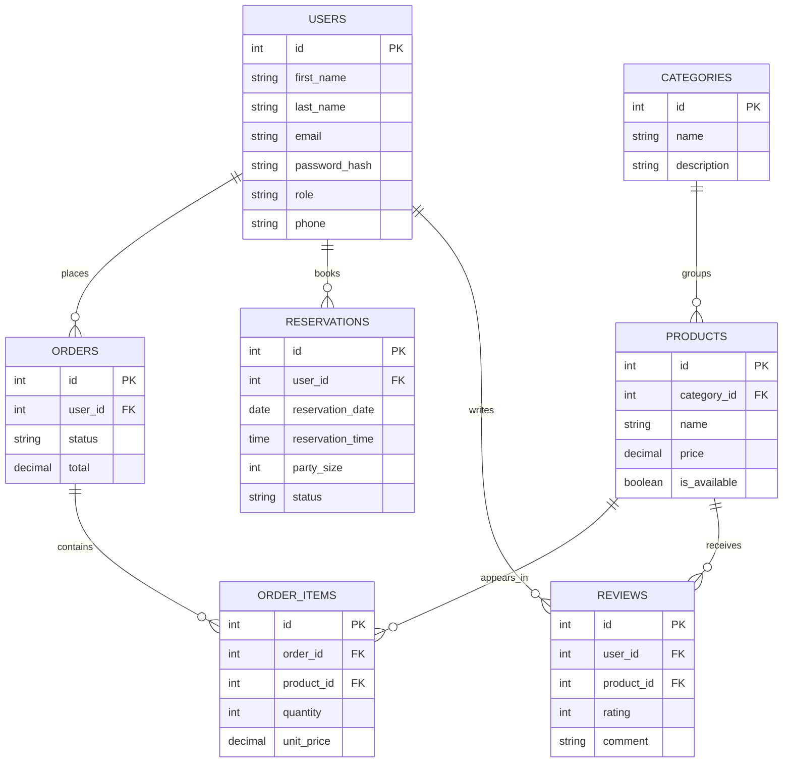

# Kod Kere — Entity-Relationship Diagram (Milestone 2)

Open [`erd.html`](erd.html) in a browser for the visual diagram.

Schema file: [`database/kod_kere.sql`](../database/kod_kere.sql)

## Entities

| Table | Purpose |
| --- | --- |
| **users** | Customers and admins (`admin`, `customer`) |
| **categories** | Menu groups |
| **products** | Drinks and pastry |
| **reservations** | Table bookings |
| **orders** | Cafe orders |
| **reviews** | Ratings and comments |
| order_items | Line items on an order (CRUD through `OrderItemDao`) |

## Relationships

- A **user** places many **orders** and many **reservations**, and may write many **reviews**.
- A **category** contains many **products**.
- An **order** contains many **products** through **order_items**.
- A **review** belongs to a **user** and optionally to a **product**.

## Attributes

```
users(id PK, first_name, last_name, email UNIQUE, password_hash, role, phone, created_at)
categories(id PK, name UNIQUE, description)
products(id PK, category_id FK, name, description, price, image_url, is_available)
reservations(id PK, user_id FK, reservation_date, reservation_time, party_size, status, notes)
orders(id PK, user_id FK, status, total, created_at)
order_items(id PK, order_id FK, product_id FK, quantity, unit_price)
reviews(id PK, user_id FK, product_id FK NULL, rating, comment, created_at)
```

Foreign keys:

- `products.category_id` → `categories.id` (`ON DELETE RESTRICT`)
- `reservations.user_id` → `users.id` (`ON DELETE CASCADE`)
- `orders.user_id` → `users.id` (`ON DELETE CASCADE`)
- `order_items.order_id` → `orders.id` (`ON DELETE CASCADE`)
- `order_items.product_id` → `products.id` (`ON DELETE RESTRICT`)
- `reviews.user_id` → `users.id` (`ON DELETE CASCADE`)
- `reviews.product_id` → `products.id` (`ON DELETE SET NULL`)

## Mermaid ERD


