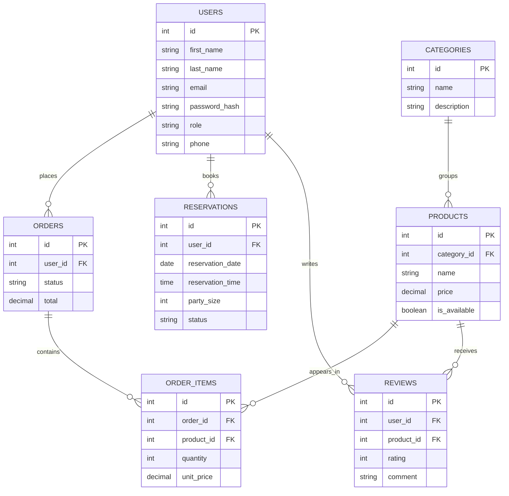

# Kod Kere — draft Entity-Relationship Diagram (Milestone 1)

Open `"C:\Users\kerim\Desktop\kod-kere\docs\erd.html"` in a browser for the visual diagram.

## Entities (6 + order_items)

| Entity | Purpose |
| --- | --- |
| **users** | Customers and admins. Roles: `admin`, `customer`. |
| **categories** | Menu groups (hot drinks, cold drinks, pastry). |
| **products** | Drinks and food on the menu. |
| **reservations** | Table bookings for a date, time, and party size. |
| **orders** | Customer orders with a status and total. |
| **reviews** | Guest ratings and comments. |
| order_items | Line items on an order (not a standalone screen; CRUD goes through orders). |

## Relationships

- A **user** places many **orders** and many **reservations**, and may write many **reviews**.
- A **category** contains many **products**.
- An **order** contains many **products** through **order_items**.
- A **review** belongs to a **user** and optionally to a **product**.

## Draft attributes

```
users(id PK, first_name, last_name, email UNIQUE, password_hash, role, phone, created_at)
categories(id PK, name UNIQUE, description)
products(id PK, category_id FK, name, description, price, image_url, is_available)
reservations(id PK, user_id FK, reservation_date, reservation_time, party_size, status, notes)
orders(id PK, user_id FK, status, total, created_at)
order_items(id PK, order_id FK, product_id FK, quantity, unit_price)
reviews(id PK, user_id FK, product_id FK NULL, rating, comment, created_at)
```

## Mermaid ERD



MySQL `.sql` with sample data is Milestone 2.
